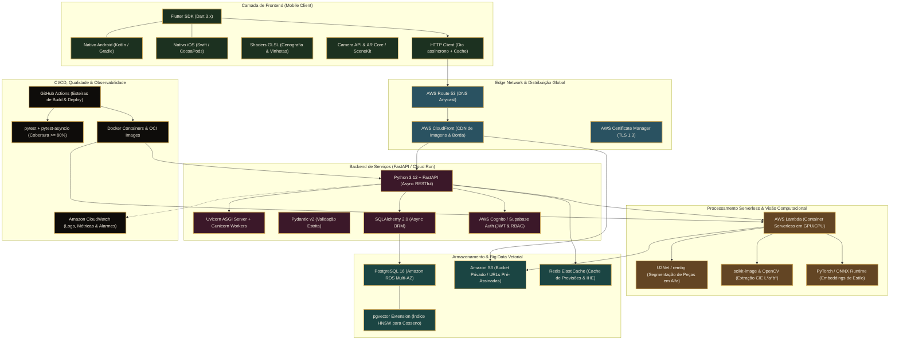
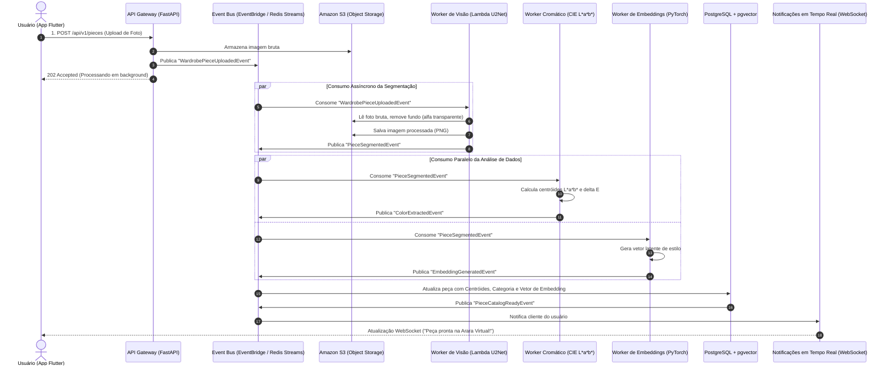

# CENTRO UNIVERSITÁRIO ÁLVARES PENTEADO — FECAP
## Curso de Bacharelado em Ciência da Computação
**Disciplina:** Agile Software Architecture  
**Docente:** Prof. Luis Fernando dos Santos Pires  
**Projeto Integrado:** HarmonIA — Consultoria de Estilo, Visão Computacional e Inteligência Cromática  
**Autores:**
- Sátiro Gabriel de Souza Santos
- Maria Kassandra Alves Gomes
- Rodrigo Correa da Gama
- Sabrinna Cristina Gomes Vicente  
**Ano:** 2026

---

# PARTE I — FUNDAMENTOS DE ARQUITETURA DE SOFTWARE
*(Respostas analíticas baseadas no material didático "Agile Software Architecture" e na literatura clássica de Engenharia de Software)*

---

### 1. Qual é o papel da arquitetura de software no desenvolvimento de sistemas complexos?
A arquitetura de software atua como a **planta baixa estrutural e organizacional** de uma solução computacional (Slide 2). Em sistemas complexos, ela desempenha papéis vitais:
1. **Definição dos Componentes e Comunicação:** Estabelece os principais blocos funcionais do sistema, as interfaces de integração e as diretrizes normativas para construção, garantindo que subsistemas heterogêneos operem em perfeita sintonia.
2. **Mitigação de Complexidade e Entropia:** Converte requisitos corporativos e operacionais de alta complexidade em estruturas gerenciáveis por meio da divisão de responsabilidades.
3. **Guia Estratégico de Decisões Técnicas:** Orienta a seleção de padrões de design (*design patterns*), *frameworks*, tecnologias de persistência e topologias de implantação.
4. **Garantia de Requisitos Não Funcionais (Atributos de Qualidade):** É a fundação que viabiliza escalabilidade, manutenibilidade, segurança da informação, tolerância a falhas e desempenho sustentável, assegurando que o sistema evolua ao longo do tempo sem degradação arquitetural.

---

### 2. Quais são os benefícios de utilizar uma arquitetura em camadas no desenvolvimento de software?
A arquitetura em camadas (*Layered Architecture*) divide o software em estratos horizontais lógicos — como Apresentação, Regras de Negócio (*Business Logic*), Serviços e Acesso a Dados (Slides 7 e 8). Seus principais benefícios são:
1. **Separação de Preocupações (*Separation of Concerns - SoC*):** Cada camada possui um escopo de atuação estrito e isolado, impedindo que detalhes de interface ou de banco interfiram na lógica de negócio essencial.
2. **Alta Manutenibilidade e Baixo Acoplamento:** Modificações internas em uma camada (por exemplo, trocar a biblioteca de banco de dados na camada de acesso a dados) não geram efeitos colaterais nas camadas superiores, desde que o contrato de interface seja preservado.
3. **Reutilização e Substituibilidade de Componentes:** Componentes de lógica ou de serviço podem ser consumidos por múltiplas interfaces (web, mobile, APIs públicas) sem duplicação de regras.
4. **Facilidade de Testes e Especialização da Equipe:** Permite testes unitários isolados por camada através de *mocks* e *stubs*, além de possibilitar a especialização do time técnico (desenvolvedores *front-end*, engenheiros de dados e especialistas em regras de negócio trabalhando de forma independente).

---

### 3. Como os diagramas de arquitetura de software facilitam a comunicação entre as equipes de desenvolvimento?
Os diagramas de arquitetura de software operam como **mapas visuais conceituais de alto nível** (Slides 4 e 5):
1. **Visão Holística Compartilhada (*The Big Picture*):** Permitem que arquitetos, desenvolvedores, gestores de produto (*product managers*) e analistas de qualidade compreendam instantaneamente a topologia global do sistema e as fronteiras de cada módulo.
2. **Redução da Ambiguidade Técnica:** Formalizam visualmente contratos de comunicação, fluxos de dados e direções de dependência, minimizando mal-entendidos e discussões abstratas em reuniões de alinhamento.
3. **Facilitação do *Onboarding* de Novos Membros:** Aceleram drasticamente o tempo necessário para que novos engenheiros compreendam onde novas funcionalidades devem ser injetadas sem quebrar a coerência estrutural.
4. **Base para Tomada de Decisão e Governança:** Servem de substrato analítico para auditorias de segurança, planejamento de refatorações, análises de gargalos de rede e alocação orçamentária de infraestrutura em nuvem.

---

### 4. Quais são os elementos comuns que devem ser representados em um diagrama de arquitetura de software?
Conforme evidenciado nos modelos corporativos e simbologias de arquitetura corporativa (Slide 6, 10 e 14), os elementos fundamentais incluem:
1. **Atores e Clientes (*Clients / Consumers*):** Dispositivos de acesso (aplicativos móveis, navegadores web, sensores IoT, usuários com diferentes papéis operacionais).
2. **Pontos de Entrada e Roteamento (*Gateways & Edge*):** Balanceadores de carga (*load balancers*), CDN (*Content Delivery Networks*), DNS e *API Gateways* com filtros de segurança.
3. **Serviços e Componentes de Processamento (*Services & Logic*):** Servidores de aplicação, módulos de lógica de negócios, funções *serverless* e *workers* especializados.
4. **Canais e Conectores de Comunicação (*Connectors & Pipes*):** Setas direcionadas com o protocolo especificado (HTTPS/REST, WebSockets, gRPC, TCP/IP) expressando o sentido das requisições e respostas.
5. **Mecanismos de Mensageria e Eventos (*Event Bus / Streaming*):** Tópicos de mensageria, filas assíncronas (*Enterprise Service Bus*, Kafka, RabbitMQ) para comunicação desacoplada.
6. **Módulos de Armazenamento e Persistência (*Datastores*):** Bancos relacionais, bancos vetoriais, bancos de documentos (*NoSQL*), *caches* em memória e *object storage* (S3).
7. **Fronteiras Lógicas e de Rede (*Boundaries & Subnets*):** Delimitação de zonas seguras (*firewalls*, redes privadas VPC, camadas de autorização/RBAC).

---

### 5. Como a arquitetura cliente-servidor promove escalabilidade e flexibilidade em sistemas distribuídos?
A arquitetura cliente-servidor estabelece uma clara cisão entre **solicitantes** (*clientes*) e **provedores centralizados** (*servidores*), conectados por protocolos de rede padrão como TCP/IP e HTTP (Slides 12 e 13). Essa divisão promove:
1. **Desacoplamento de Ciclos de Vida:** O cliente (ex.: aplicativo móvel Flutter) e o servidor (ex.: API FastAPI) evoluem, recebem manutenções e são lançados independentemente, desde que mantenham os contratos de API.
2. **Escalabilidade Horizontal Independente:** O parque de servidores pode ser escalado sob demanda (adicionando novas instâncias de contêineres ou nós de computação atrás de um balanceador) de acordo com o volume de tráfego, sem que os clientes precisem saber onde a requisição foi atendida.
3. **Centralização de Regras Críticas e Segurança:** Garante integridade de dados e proteção da propriedade intelectual no lado do servidor, evitando que regras de negócio sensíveis fiquem expostas no código client-side.
4. **Multiplataforma Nativa:** Um único cluster de servidores atende simultaneamente uma vasta gama de clientes heterogêneos (Android, iOS, Web, Smart TVs, parceiros via API).

---

### 6. De que forma o padrão MVC separa as responsabilidades no desenvolvimento de software?
O padrão *Model-View-Controller* (MVC) organiza a aplicação em três componentes com atribuições perfeitamente demarcadas (Slides 15 e 16):
1. **Model (Modelo):** Detém a lógica de negócio intrínseca, regras de cálculo, estruturas de domínio e interação com a camada de persistência. O modelo não tem nenhuma ciência sobre a interface gráfica ou sobre como seus dados serão renderizados em tela.
2. **View (Visualização):** Responsável estritamente pela representação visual dos dados para o usuário final. Captura as intenções do usuário (gestos, cliques) e as repassa ao Controlador; consome dados do Modelo apenas para renderização.
3. **Controller (Controlador):** Atua como o coordenador e intermediário. Recebe as entradas dos clientes, valida os parâmetros, comanda as alterações de estado no Modelo e seleciona qual Visualização deve ser entregue ou atualizada em resposta.
*Impacto:* A separação impede a proliferação de código espaguete, permitindo trocar integralmente a interface de usuário (*View*) sem alterar uma única linha da lógica de negócios (*Model*).

---

### 7. Quais são as vantagens da arquitetura orientada a serviços (SOA) em ambientes empresariais?
A Arquitetura Orientada a Serviços (SOA) compõe o sistema por meio de serviços autônomos, fracamente acoplados e com contratos bem definidos, frequentemente orquestrados por um barramento de serviços corporativo (*Enterprise Service Bus - ESB*) (Slide 17):
1. **Interoperabilidade Tecnológica:** Permite integrar com fluidez aplicações legadas, novos sistemas em nuvem e softwares de terceiros construídos em linguagens e plataformas distintas através de interfaces universais (REST, SOAP, JSON, XML).
2. **Reutilização de Ativos Corporativos:** Serviços nucleares (como autenticação de clientes, faturamento, auditoria de dados e verificação de crédito) são construídos uma única vez e reaproveitados por dezenas de portais, aplicativos e subsidiárias da organização.
3. **Agilidade e Adaptabilidade aos Negócios:** Processos de negócios complexos (BPM/BPA) podem ser reorganizados e alterados rapidamente apenas recompondo a cadeia de chamada dos serviços existentes.
4. **Governança Centralizada:** Facilita a auditoria de acessos, a implementação de políticas de segurança unificadas (*Single Sign-On*, RBAC) e o monitoramento central de tráfego corporativo.

---

### 8. Como o padrão Pipes and Filters ajuda a modularizar e escalar processos de dados complexos?
O padrão *Pipes and Filters* decompõe tarefas computacionais extensas em uma cadeia linear de **filtros** independentes conectados por canais de transmissão de dados chamados **pipes** (Slides 18 e 19):
1. **Alta Coesão e Especialização:** Cada filtro é uma caixa-preta dedicada a uma transformação atômica e bem definida (ex.: *scanner*, conversão de formato, remoção de ruídos, enriquecimento de metadados, validação semântica).
2. **Reconfigurabilidade e Manutenibilidade:** Filtros podem ser reordenados, adicionados ou substituídos sem modificar a estrutura dos outros módulos da esteira.
3. **Processamento Concorrente e Paralelismo:** À medida que o primeiro filtro termina de processar um bloco de dados e o envia pelo *pipe*, ele pode receber o próximo lote enquanto o filtro subsequente processa a saída anterior (*pipelining* em fluxo contínuo).
4. **Escalabilidade Focada:** Filtros computacionalmente pesados (como processamento de vídeo ou inferência de redes neurais) podem ser isolados em instâncias com recursos dedicados (ex.: GPUs) sem desperdiçar recursos nos filtros leves de validação.

---

### 9. Quais desafios podem surgir ao implementar uma arquitetura modular em sistemas grandes?
Embora a modularização seja a meta para grandes corporações, a sua implementação prática impõe desafios de engenharia significativos:
1. **Complexidade de Fronteiras de Domínio (*Bounded Contexts*):** Dificuldade em definir com exatidão os limites de cada módulo sem gerar vazamento de abstração ou duplicação indevida de dados.
2. **Gestão de Dependências e Acoplamento Oculto:** Risco de surgimento de dependências circulares ou acoplamento indireto via esquemas de banco de dados compartilhados, anulando os ganhos teóricos da modularidade.
3. **Sobrecarga de Comunicação e Latência de Rede:** Em sistemas modulares distribuídos, a troca frequente de mensagens pela rede introduz latência, serialização/desserialização custosa e vulnerabilidade a falhas parciais (*fallacies of distributed computing*).
4. **Consistência de Dados e Transações Distribuídas:** Transições de um modelo monolítico ACID para padrões modulares exigem mecanismos complexos de consistência eventual, como o padrão *Saga*, transações compensatórias e controle de concorrência.
5. **Complexidade Operacional e Observabilidade:** Exige infraestrutura sofisticada de telemetria, rastreamento distribuído (*distributed tracing* com OpenTelemetry), monitoramento de logs correlacionados e esteiras robustas de CI/CD para deploy coordenado de módulos.

---

### 10. Como a escolha da arquitetura impacta a manutenção e evolução futura do software?
A arquitetura é a decisão de engenharia de maior impacto e de maior custo de reversão em um projeto de software. Seus efeitos na evolução futura manifestam-se em:
1. **Custo Marginal de Adição de Recursos:** Uma arquitetura modular, limpa e bem desacoplada viabiliza a introdução de novas funcionalidades com custo quase linear. Em contrapartida, uma arquitetura deficiente acarreta crescimento exponencial no custo de manutenção devido ao acúmulo de débito técnico.
2. **Testabilidade e Confiabilidade de Regressão:** Arquiteturas que desacoplam regras de negócio de frameworks e de bancos de dados permitem testes automatizados rápidos e determinísticos, blindando o software contra efeitos colaterais imprevistos.
3. **Flexibilidade para Adoção de Novas Tecnologias:** Permite que componentes obsoletos sejam refatorados ou substituídos por tecnologias modernas (ex.: adotar novos modelos de IA ou novos provedores de banco de dados) sem a necessidade de reescrever todo o ecossistema.
4. **Escalabilidade Organizacional das Equipes:** Arquiteturas bem particionadas permitem que múltiplos esquadrões de engenharia (*squads*) atuem em paralelo em diferentes repositórios e serviços sem conflitos de mesclagem de código (*merge conflicts*) e sem gargalos de comunicação.

---
---

# PARTE II — O DESAFIO: ARQUITETURAS DO PROJETO HarmonIA

O projeto **HarmonIA** consiste em uma plataforma inteligente de curadoria de moda sustentável, guarda-roupa virtual, consultoria morfocromática em espaço CIE L\*a\*b\* e cálculo do Índice de Harmonia Estética (IHE), desenvolvida em Flutter (Mobile) e FastAPI/Python com PostgreSQL e pgvector.

---

## 1. Arquitetura Funcional ou Modular do Projeto HarmonIA
*(Inspirada na metodologia e estruturação funcional do modelo MentCare — Slide 11)*

A Arquitetura Funcional do HarmonIA organiza as capacidades operacionais do produto em módulos funcionais coesos, agrupados por camadas de responsabilidade: **Apresentação & Canal**, **Disponibilidade & Experiência**, **Lógica de Negócio (Core Funcional)**, **Integração & Parcerias Externas**, **Armazenamento Especializado** e **Segurança & Governança**.

### 1.1 Diagrama de Arquitetura Funcional (Mermaid)

```mermaid
flowchart TD
    %% Estilo Geral
    classDef pres fill:#2A5261,stroke:#D4AE5C,stroke-width:2px,color:#F4EEE1;
    classDef logica fill:#1C3120,stroke:#D4AE5C,stroke-width:2px,color:#F4EEE1;
    classDef integc fill:#3B1829,stroke:#D4AE5C,stroke-width:2px,color:#F4EEE1;
    classDef store fill:#634524,stroke:#D4AE5C,stroke-width:2px,color:#F4EEE1;
    classDef sec fill:#0E0C0A,stroke:#D4AE5C,stroke-width:2px,color:#F4EEE1;

    subgraph APRESENTACAO ["Camada de Apresentação (Interface Editorial & Mobile)"]
        UI_HOME["Ateliê & Look do Dia (IHE)"]:::pres
        UI_WARDROBE["Arara Virtual & Inventário"]:::pres
        UI_SCANNER["Digitalização & Scanner de Peças"]:::pres
        UI_PROVADOR["Mirror Mode (Provador AR)"]:::pres
        UI_FEED["Feed Social Editorial"]:::pres
        UI_DASHBOARD["Dashboard de Rotação de Acervo"]:::pres
    end

    subgraph DISPONIBILIDADE ["Disponibilidade & Experiência Operacional"]
        CANAL_MOBILE["App Mobile (Android / iOS)"]:::pres
        MODO_OFFLINE["Cache Local & Modo Offline"]:::pres
    end

    subgraph LOGICA_NEGOCIO ["Lógica do Negócio (Serviços e Motores Centrais)"]
        MOD_IHE["Motor de Cálculo do IHE (Harmonia Estética)"]:::logica
        MOD_VISION["Pipeline de Visão Computacional & Segmentação"]:::logica
        MOD_COLOR["Módulo de Ciência Cromática (CIE L*a*b*)"]:::logica
        MOD_WARDROBE["Gestão de Acervo, Taxonomia & Cápsulas"]:::logica
        MOD_AFFIL["Gap Analysis & Motor de Recomendação de Compras"]:::logica
        MOD_SOCIAL["Feed Comunitário, Reações & Moodboards"]:::logica
    end

    subgraph SEGURANCA ["Segurança, Governança & LGPD"]
        AUTH_JWT["Autenticação e Sessão (Tokens JWT / RBAC)"]:::sec
        CRIPTO["Criptografia AES-256 e TLS 1.3"]:::sec
        LGPD_MOD["Gestão de Consentimento & Expurgador LGPD (24h)"]:::sec
    end

    subgraph INTEGRACAO ["Integração & Serviços Externos"]
        API_METEO["API Meteorológica Externa (Clima & Temperatura)"]:::integc
        API_ECOMM["APIs de E-commerce Parceiro (C&A e Lojas Renner)"]:::integc
        PUSH_SRV["Serviço de Notificações Push & Alertas de Uso"]:::integc
    end

    subgraph ARMAZENAMENTO ["Armazenamento & Persistência"]
        DB_POSTGRES["Banco Central Relacional (PostgreSQL)"]:::store
        DB_PGVECTOR["Motor Vetorial (pgvector - Embeddings)"]:::store
        STORAGE_S3["Object Storage (Imagens Transparentes em S3)"]:::store
        CACHE_REDIS["Cache em Memória (Redis - Sessões e IHE)"]:::store
    end

    %% Relações e Fluxos
    CANAL_MOBILE --> APRESENTACAO
    APRESENTACAO --> MOD_WARDROBE
    APRESENTACAO --> MOD_IHE
    APRESENTACAO --> MOD_VISION
    APRESENTACAO --> MOD_PROVADOR
    APRESENTACAO --> UI_FEED

    MOD_IHE --> MOD_COLOR
    MOD_VISION --> MOD_COLOR
    MOD_IHE --> API_METEO
    MOD_AFFIL --> API_ECOMM
    MOD_WARDROBE --> MOD_AFFIL

    APRESENTACAO -.-> AUTH_JWT
    LOGICA_NEGOCIO -.-> SEGURANCA

    MOD_WARDROBE --> DB_POSTGRES
    MOD_VISION --> STORAGE_S3
    MOD_IHE --> DB_PGVECTOR
    MOD_IHE --> CACHE_REDIS
    LOGICA_NEGOCIO --> DB_POSTGRES
```

### 1.2 Detalhamento dos Módulos Funcionais

| Módulo Funcional | Responsabilidade Primária | Regras de Negócio & RNF Associados |
| :--- | :--- | :--- |
| **Ateliê & Arara Virtual** | Visualização do patrimônio de roupas em canvas infinito, organização por categorias e filtros dinâmicos de estação e formalidade. | RF06, RNF06 (Regra dos 3 Toques), RN01 (Isolamento Multi-Tenant). |
| **Motor IHE (Índice de Harmonia Estética)** | Cálculo do score multimodal ponderado: $IHE = w_c \cdot S_{cor} + w_m \cdot S_{bio} + w_o \cdot S_{ocasion} + w_v \cdot S_{cos}$. Classifica looks com $\ge 75\%$ como "Fortemente Recomendados". | RF07, RNF03 (Tempo $< 1,5s$), RN02 (Cota Freemium de 5 looks/dia). |
| **Pipeline de Visão & Segmentação** | Remoção automática de fundo em fotos via rede neural U2Net, isolamento de canal alfa e geração de recortes padronizados de catálogo. | RF03, RF04, RNF03 (Processamento $< 3,5s$). |
| **Módulo Cromático (CIE L\*a\*b\*)** | Extração de centróides dominantes de tecido e cálculo da distância euclidiana $\Delta E^*_{ab}$ contra a cartela sazonal expandida do usuário. | RF02, RF05. |
| **Mirror Mode (Provador AR)** | Sobreposição de peças do armário virtual sobre a silhueta em tempo real via câmera frontal e detecção de pontos corporais. | RF08, RF10. |
| **Gap Analysis & Afiliação** | Análise diagnóstica de peças faltantes no armário e geração de links parametrizados de afiliados (C&A e Renner) com checagem de estoque. | RF11, RF12, RN03 (Ocultação de produtos esgotados). |
| **Feed Social Editorial** | Publicação de looks, curadoria de moodboards privados e busca segmentada por biótipo e cartela de cores. | RF14, RF15, RN05 (Privacidade pública vs. privada). |
| **Módulo LGPD & Expurgador** | Revogação de consentimento, anonimização e deleção física definitiva de fotos no S3 e metadados no banco em até 24h. | RNF01, RN04 (Direito ao esquecimento). |

---

## 2. Arquitetura Técnica do Projeto HarmonIA
*(Inspirada na estrutura da Arquitetura Técnica corporativa da Netflix — Slide 14)*

A Arquitetura Técnica detalha a pilha de tecnologias, servidores, componentes de computação em nuvem, bancos de dados, orquestradores e esteiras de automação que sustentam a aplicação em escala de produção.

### 2.1 Diagrama de Arquitetura Técnica (Mermaid)

### 2.2 Mapeamento de Camadas Técnicas

| Camada Técnica | Tecnologia Adotada | Finalidade na Engenharia da Solução |
| :--- | :--- | :--- |
| **Frontend Mobile** | **Flutter / Dart** | Permite desenvolvimento unificado com compilação nativa para iOS e Android a partir de uma base de código única, com tipagem forte e alto desempenho de renderização a 60/120 fps. |
| **Apresentação Cenográfica** | **Custom Shaders GLSL / Skia** | Renderização em hardware de fundos pictóricos em tons de joia, texturas drapeadas e vinhetas sem impacto no thread de UI. |
| **Rede de Distribuição (CDN)** | **AWS CloudFront + Route 53** | Distribuição de imagens tratadas em servidores de borda (*Edge Locations*), eliminando latência no carregamento de itens de catálogo. |
| **API Principal** | **Python 3.12 / FastAPI** | Prover endpoints RESTful de alta velocidade com I/O não bloqueante (*async/await*), integração natural com ecossistemas de Machine Learning e documentação OpenAPI nativa. |
| **Processamento Paralelo Serverless** | **AWS Lambda (OCI Containers)** | Execução desacoplada de processamento pesado de visão computacional (U2Net, remoção de fundo e extração de cor), escalando a zero quando inativa para conter custos. |
| **Banco Relacional & Vetorial** | **PostgreSQL 16 + pgvector** | Persistência transacional com garantia ACID associada à busca vetorial indexada por HNSW/IVFFlat, viabilizando busca por similaridade de cosseno diretamente no motor do banco. |
| **Object Storage** | **Amazon S3 (Bucket Criptografado)** | Armazenamento de alta durabilidade (99,999999999%) para fotos originais e PNGs com canal alfa transparente, acessadas somente via URLs pré-assinadas temporárias. |
| **Autenticação & Controle de Acesso** | **AWS Cognito / Supabase Auth** | Emissão de tokens JWT com expiração curta e implementação de RBAC (*Role-Based Access Control*), atendendo aos requisitos estritos da LGPD. |
| **Esteira CI/CD & Testes** | **GitHub Actions + pytest** | Validação automatizada a cada Pull Request, exigindo 80% de cobertura de testes unitários e de integração antes do deploy contínuo em produção. |

---

## 3. Padrão de Arquitetura Inovador Aplicado ao Projeto: Event-Driven Architecture (EDA)
*(Padrão não listado entre os tópicos conceituais anteriores: Camadas, Cliente-Servidor, MVC, SOA ou Pipes & Filters)*

### 3.1 Justificativa da Escolha da Arquitetura Orientada a Eventos (EDA)
Enquanto as arquiteturas mencionadas anteriormente utilizam comunicações síncronas cliente-servidor ou orquestrações de barramento centralizado (SOA tradicional com ESB), o **HarmonIA** lida com operações assíncronas assimetricamente pesadas:
- O usuário tira uma foto no provador ou em casa e deseja feedback instantâneo na interface (cumprindo a **Regra dos 3 Toques** e o RNF03 de resposta rápida).
- A segmentação de imagem (U2Net), o cálculo da distância de cor no espaço $L^*a^*b^*$ e a geração dos embeddings multidimensionais de estilo demandam até 3,5 segundos de processamento computacional intensivo.
- Se esse pipeline fosse síncrono (*Request-Response* tradicional), a conexão ficaria presa, o dispositivo móvel sofreria com consumo excessivo de bateria e qualquer lentidão de GPU geraria *Timeouts* na API.

Portanto, a solução ideal para desacoplar a ingestão da execução analítica é a **Event-Driven Architecture (EDA — Arquitetura Orientada a Eventos)**, complementada internamente pela **Arquitetura Hexagonal (Ports & Adapters)** nos serviços de domínio.

### 3.2 Como o Padrão Funciona na Prática no HarmonIA
Na arquitetura EDA, o fluxo é regido pela produção, transmissão e consumo de **Eventos de Domínio imutáveis**:

1. **Emissão do Evento de Upload:** O usuário fotografa uma peça; o aplicativo envia o binário para o S3 via URL pré-assinada e notifica a API. A API emite imediatamente o evento `WardrobePieceUploadedEvent` para o barramento de eventos (ex.: AWS EventBridge ou Redis Streams) e devolve resposta `202 Accepted` ao aplicativo em menos de 100ms.
2. **Consumo Paralelo por Múltiplos Assinantes Autônomos:**
   - **Assinante 1 (Visão Computacional):** Uma função Lambda consome o evento, executa a segmentação de máscara com U2Net, grava o PNG recortado no bucket e emite o evento `PieceSegmentedEvent`.
   - **Assinante 2 (Extrator Cromático):** O serviço de cores consome `PieceSegmentedEvent`, analisa os centróides de cor no espaço CIE $L^*a^*b^*$ e emite `ColorExtractedEvent`.
   - **Assinante 3 (Motor de Embeddings):** O serviço de IA projeta a peça no espaço vetorial latente e emite `StyleEmbeddingCalculatedEvent`.
3. **Agregação e Atualização Final:**
   - O serviço de persistência assina a conclusão das etapas, atualiza o registro do guarda-roupa no PostgreSQL com os novos vetores `pgvector` e emite `PieceCatalogReadyEvent`.
   - O serviço de Notificações emite uma mensagem via WebSocket / Push para o smartphone: a peça aparece na **Arara Virtual** com animação teatral, perfeitamente recortada.
   - O motor de **Gap Analysis** é acionado em segundo plano para reavaliar possíveis combinações com as lojas parceiras (Renner e C&A) sem onerar a experiência imediata do usuário.

### 3.3 Diagrama de Sequência e Fluxo da Arquitetura Orientada a Eventos (Mermaid)

### 3.4 Benefícios Concretos da EDA para o HarmonIA

1. **Zero Travamento de Interface (UI Não Bloqueante):** O usuário pode continuar navegando pela arara virtual ou montando outros looks enquanto o processamento pesado de visão computacional ocorre nos bastidores.
2. **Escalabilidade Elástica Independente:** Durante picos de uso (ex.: campanhas de Black Friday ou fins de semana de compras em shoppings), os workers de visão computacional e de IA escalam horizontalmente no cluster serverless sem comprometer a latência dos endpoints de leitura da API principal.
3. **Resiliência a Falhas e Recuperação Graciosa:** Se o serviço de embeddings sofrer instabilidade passageira, o evento fica retido na fila com política de retentativa (*Dead Letter Queue - DLQ*), garantindo que nenhuma foto tirada pelo usuário seja perdida.
4. **Extensibilidade Sem Impacto:** Adicionar um novo recurso no futuro (por exemplo, um serviço que detecta sustentabilidade têxtil ou gera descrição em linguagem natural via LLM) exige apenas plugar um novo consumidor no barramento de eventos, sem alterar uma única linha de código dos serviços já existentes.

---
*(Documento elaborado para avaliação curricular — FECAP 2026)*
